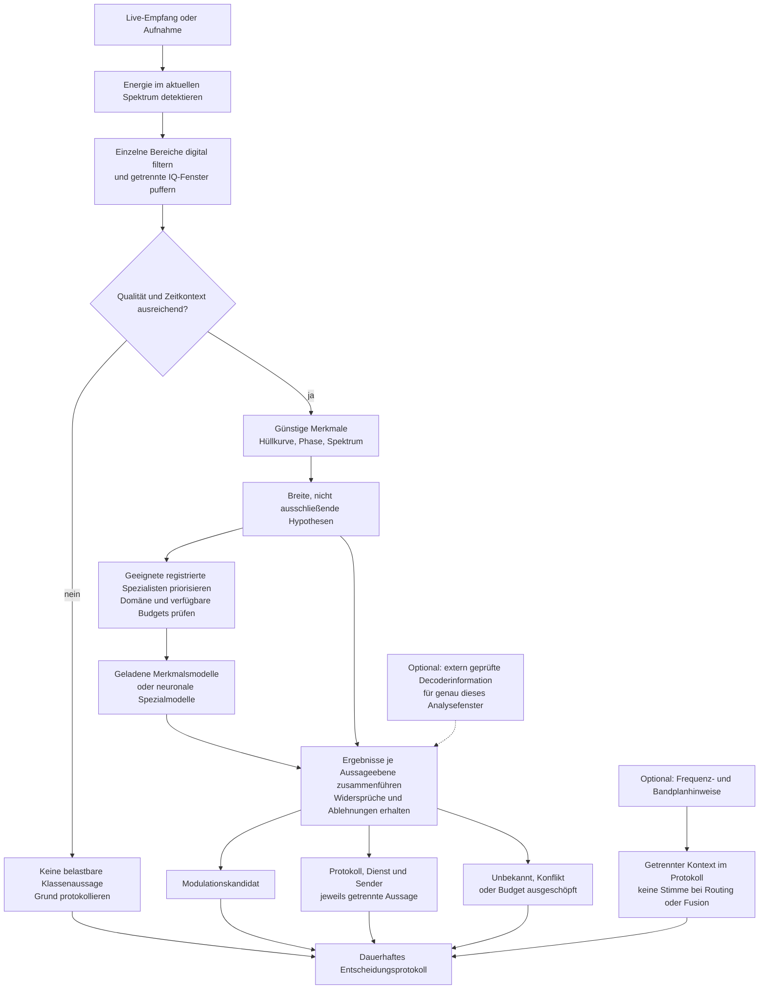

# Einzelne Signale untersuchen und Entscheidungen nachvollziehen

Die Analyse verbindet eine einfache Frage mit einer überprüfbaren Antwort: **Welches Signal wurde in welchem Empfangsfenster untersucht, welche Prüfungen wurden ausgeführt und wie weit trägt das Ergebnis?** Eine Antwort darf auch „unbekannt“, „widersprüchlich“ oder „noch nicht untersucht“ lauten. Eine erkennbare Energiespitze im Spektrum ist für sich genommen weder eine bestätigte Modulationsart noch ein bestimmter Sender.

Ein softwaredefinierter Funkempfänger, kurz **SDR** für *Software Defined Radio*, liefert digitale Inphase- und Quadraturdaten, kurz **IQ-Daten**. Diese beiden Komponenten beschreiben gemeinsam Amplitude und Phase des empfangenen Signals. Sowohl Live-Empfang als auch die Wiedergabe einer Aufnahme können dieselbe Signalanalyse durchlaufen. Synthetische Daten bleiben als solche gekennzeichnet. Eine fehlende Synthesekennzeichnung in einer fremden Datei bestätigt keinen realen oder authentifizierten Funkempfang.

## Was eine Aussage bedeutet

Die Software trennt fünf Ebenen. Ein Ergebnis auf einer Ebene füllt die anderen Ebenen nicht automatisch aus.

| Ebene | Beispiel | Bedeutung und Grenze |
| --- | --- | --- |
| Signalform | einträgerartig, mehrträgerartig, chirpartig, pulsartig | Grobe, möglicherweise gleichzeitig zutreffende Merkmalsvorschläge. Ein Chirp ist ein zeitlicher Frequenzdurchlauf. |
| Modulation | Amplitudenmodulation (**AM**), Frequenzmodulation (**FM**) | Beschreibt, wie Information die Trägerwelle verändert. FM beweist keinen Rundfunksender; AM beweist keinen Flugfunk. |
| Verfahren oder Protokoll | **LoRa** (*Long Range*), **POCSAG** (*Post Office Code Standardisation Advisory Group*, ein Funkrufverfahren) | Erfordert ein geeignetes trainiertes Modell für einen Kandidaten oder konkrete, geprüfte Decoderinformationen für eine beobachtete Protokollaussage. |
| Funkdienst | Rundfunk, Flugfunk, Telemetrie | Beschreibt die Anwendung. Gleiche Modulationen können in verschiedenen Funkdiensten vorkommen. |
| Senderidentität | eine bestimmte Station oder ein bestimmtes Gerät | Ist die stärkste und anspruchsvollste Zuordnung. Ein Modelllabel und eine Kanalnummer authentifizieren keinen Sender. |

Ein weiteres Beispiel: **CSS** bedeutet *Chirp Spread Spectrum*, ein Spreizverfahren mit Frequenzdurchläufen. Ein chirpartiges Signal kann einen CSS-Experten interessant machen. Es bestätigt weder LoRa noch **LoRaWAN** (*Long Range Wide Area Network*, ein darauf aufbauendes Netzwerkprotokoll). Ebenso ist **OFDM**, *Orthogonal Frequency Division Multiplexing*, eine orthogonale Mehrträgerübertragung. Ein breites, rauschartiges Spektrum kann dazu passen, kann aber auch Rauschen oder ein anderes Verfahren sein.

Der Katalog in der Oberfläche ist eine gemeinsame Sprache für Labels, Expertenprofile und Ergebnisse. **Er ist keine Sammlung bereits trainierter Universalklassifikatoren.** Ein Eintrag bedeutet auch nicht, dass dafür ein Funkdecoder installiert ist. Bestehende AM/FM-Modelle erhalten durch den größeren Katalog keine zusätzlichen gelernten Klassen. Für neue Klassen werden geeignete Daten, Labels, Training und eine unabhängige Auswertung benötigt.

## Der Entscheidungsweg



### Detektion und Kanalisierung

Der Empfänger untersucht die Energieverteilung im **momentanen** Empfangsfenster. Die Detektionsschwelle bezieht sich auf den geschätzten Hintergrund der digitalen Spektralwerte. Das ist kein kalibrierter Grenzwert für die empfangene Hochfrequenzleistung. Die Anzeige in **dBFS**, *Decibels relative to Full Scale*, beschreibt einen digitalen Pegel relativ zum Vollmaß; sie ist keine Angabe der Leistung an der Antenne.

Für zugelassene Detektionen entstehen eigene digitale Filter und begrenzte Ringspeicher. Die IQ-Daten verschiedener Kanäle werden nicht zu einem vermeintlich einzelnen Signal zusammengeschoben. Ein Kanal kann trotzdem mehrere überlagerte Sender enthalten oder nur einen angeschnittenen Teil eines Signals erfassen. Energiesuche garantiert keine vollständige Erkennung schwacher, kurzer, überlagerter oder rauschartiger Signale.

Werden keine isolierten Energiebereiche detektiert, kann zusätzlich eine begrenzte Probe des gesamten aktuellen Fensters untersucht werden. Diese **ungeklärte Fensterprobe** kann Hinweise auf rauschartige Nutzsignale liefern; sie gilt nicht als bestätigte Detektion eines einzelnen Senders. Ihre Schlussfolgerungen und Warnungen bleiben von den isolierten Kanalbefunden unterscheidbar.

Kanalnummern bezeichnen Filterkontexte. Sie können bei gleicher Quelle trotz wechselnder Signalstärke erhalten bleiben. Ein Neustart, eine andere Abstimmung oder Abtastrate, ein ersetzter Filter oder das Verschwinden und Wiederauftauchen eines Kanals erzeugt einen neuen Kontext. **Eine Kanalnummer ist keine Senderidentität.** Bei einem Scan sind Besuche desselben Frequenzbereichs deshalb nicht automatisch derselbe physische Sender.

### Qualität vor Klassifikation

Die Qualitätsprüfung betrachtet unter anderem die Zahl der Samples, endliche Zahlenwerte, digitalen Mindestpegel und bekannte Sprünge innerhalb des Fensters. Ein ausdrücklich als unterbrochen markiertes Fenster wird nicht wie ein zusammenhängender Zeitabschnitt klassifiziert. Starkes gemeldetes Clipping, also eine Begrenzung durch Übersteuerung, verhindert ebenfalls eine verlässliche Modulationsaussage. Noch nicht eingeschwungene Filter und Signale am Spektralrand werden kenntlich gemacht.

Softwareseitig geordnete Sampleindizes beweisen keine lückenlose physische Funkaufnahme. Zeitangaben stammen grundsätzlich aus dem Empfangsrechner; sie sind keine nachgewiesenen Zeitstempel einzelner Funksamples. Ein gemeldeter Überlauf irgendwo in der Quelle beweist umgekehrt nicht automatisch einen Sprung innerhalb jedes untersuchten Fensters. Der Zusammenhang wird im Qualitätskontext festgehalten.

Es gibt in der übergeordneten Entscheidung **kein allgemeines Rauschgate**, das ein flaches Spektrum pauschal entfernt. Das würde beispielsweise Mehrträger- und Spreizsignale benachteiligen. Eine günstige AM/FM-Domänenprüfung bleibt innerhalb des jeweiligen AM/FM-Experten; dessen Ablehnung stoppt andere Experten nicht.

### Merkmale, Hypothesen und Spezialisten

Günstige Merkmale beschreiben beispielsweise die Schwankung der Hüllkurve, Phasenänderungen, die Verteilung der Energie im Spektrum und die zeitliche Bewegung einer Spektralspitze. Sie erzeugen begründete Hypothesen und priorisieren Spezialisten. Mehrere Hypothesen dürfen nebeneinander stehen. Ihr Unterstützungswert ist eine Heuristik und keine kalibrierte Wahrscheinlichkeit.

Ein registriertes Expertenprofil verbindet ein vorhandenes gespeichertes Modell mit seiner vorgesehenen Aussageebene und optional passenden Modulations- oder Signalformfamilien. Profile mit passenden Merkmalsvorschlägen werden bevorzugt geprüft; andere können innerhalb des Budgets explorativ folgen. Frequenz und Bandplan entscheiden diese Reihenfolge nicht. Sie werden auf Wunsch als eigener Kontext angezeigt und weder bei der Expertenauswahl noch bei der Zusammenführung als Klassenvotum verwendet.

Vor einer Modellinferenz, also der Anwendung eines trainierten Modells, werden die gespeicherte Klassenliste, Eingabedarstellung, Segmentlänge und der dokumentierte Auswertungsstatus betrachtet. Standardmäßig werden nur Modelle mit dokumentierter unabhängiger Auswertung eingesetzt. Eine unbekannte oder abweichende Trainingsabtastrate wird als Gültigkeitsgrenze berichtet; sie wird nicht durch eine behauptete Generalisierung ersetzt.

Das gemeinsame Merkmalsfenster enthält höchstens 65 536 Samples. Jeder Experte verwendet daraus die für sein gespeichertes Modell benötigte zusammenhängende Segmentlänge. Standardmäßig wird am **Ende** ausgerichtet, damit der jüngste Abschnitt untersucht wird. Zu wenige Samples führen zu einer sichtbaren Auslassung; fehlende Zeitgeschichte wird nicht still ergänzt. Bei einer anderen Ausrichtung oder Segmentlänge können Merkmale und Expertenausgaben verschiedene, ausdrücklich protokollierte Ausschnitte betreffen.

### Zusammenführen und bewusst offenlassen

Ein Spezialist bewertet zunächst nur seine gespeicherten Klassen. Ein hoher Score besagt nicht, dass andere, beim Training unbekannte Alternativen ausgeschlossen sind. Die Standardregeln verlangen mindestens einen Modellscore von 0,65 und einen Abstand von 0,15 zwischen den beiden führenden Klassen; eine strengere im Modell gespeicherte Grenze gilt zusätzlich. Diese Grenzen sind veränderbar, ersetzen aber keine Validierung mit unbekannten Gegenbeispielen.

Stimmen zulässige Kandidaten derselben Aussageebene überein, bleiben ihre einzelnen Modellwerte erhalten. Widersprechen sie einander, lautet die Schlussfolgerung „Konflikt“. Nicht vergleichbare Scores verschiedener Modelle werden nicht zu einer vermeintlichen Gesamtwahrscheinlichkeit gemittelt. Fehlende, fehlerhafte oder ablehnende Spezialisten erzeugen keine Ersatzvorhersage aus der Empfangsfrequenz.

Eine grobe Signalform und ihre Spezialisierung müssen sich dabei nicht widersprechen: „mehrträgerartig“ und OFDM sind vereinbar, ebenso „chirpartig“ und CSS. **QAM**, *Quadrature Amplitude Modulation* oder Quadraturamplitudenmodulation, kann beispielsweise die einzelnen Träger einer OFDM-Übertragung modulieren. Deshalb bleiben Signalform und Modulation getrennt; unvereinbare Kandidaten werden weiterhin als Konflikt erhalten.

„Unbekannt“ bedeutet hier, dass die vorhandenen Prüfungen keine ausreichende Aussage tragen. Es ist **kein bereits empirisch bestätigter universeller Unbekannt-Klassifikator**. Für eine solche Aussage wären unabhängige unbekannte Signalarten und eine passende Fehlalarm-/Ablehnungsbewertung nötig. Eine gute AM/FM-Testgenauigkeit allein liefert diesen Nachweis nicht.

Die Entscheidungsschnittstelle kann zusätzlich extern geprüfte Decoderinformationen übernehmen. Dafür müssen unter anderem Decodername, bestandene Prüfungen, Prüfverfahren und ein zum gemeinsamen Analysefenster passender Sample-Prüfwert angegeben sein. Ein beliebiger Text „POCSAG“ genügt nicht. Diese Schnittstelle implementiert selbst keinen universellen Funkdecoder. Auch eine bestandene Paketprüfung authentifiziert den Inhalt oder die Senderidentität nicht kryptographisch.

## Bedienung im Analyse-Tab

1. Unter **Empfang** die tatsächliche Quelle wählen: PlutoSDR, SDRplay RSP1A oder eine Aufnahme. RSP steht beim Produktnamen für *Radio Spectrum Processor*. Simulation wird ausdrücklich gewählt und bleibt gekennzeichnet. Ein Hardwarefehler startet keine Simulation als Ersatz.
2. Im **Analyse-Tab** den gewünschten Frequenzbereich, das Analyseintervall und das Signalbudget festlegen. Der Bereich wirkt zunächst als Filter für die Analyse; er stimmt den Empfänger nicht automatisch über alle Frequenzen ab.
3. Unter **Verfügbare Experten** bereits trainierte/importierte Modelle aktivieren. Aussageebene und passende Familien bewusst eintragen. Das globale aktive Modell kann zusätzlich aufgenommen werden, sofern es nicht schon registriert ist.
4. Aufnahme oder Live-Empfang starten. In der Signalliste eine konkrete Beobachtung auswählen. Zeit, Quelle, Kanal, Merkmale, Expertenwahl, ausgelassene Prüfungen und getrennte Schlussfolgerungen gemeinsam lesen. Ein noch nicht analysierter Kanal ist kein negativer Klassenbefund.
5. Für einen Frequenzscan zunächst mit **Scan planen** den Plan berechnen: erreichbare Fenster, nicht abgedeckte Bereiche und Mindestdauer kontrollieren. Erst anschließend den Scan starten. Während eines Scans erfolgen manuelles Abstimmen und Stoppen über die Scansteuerung, damit keine fremde Empfangssitzung beendet wird.
6. Bei Bedarf eine gespeicherte Aufnahme einzeln auswerten oder **Modelleinflüsse mitberechnen** aktivieren. Das Entscheidungsprotokoll herunterladen, wenn eine konkrete Analyse später verglichen werden soll.

Für die Mehrsignalanalyse einer breitbandigen Aufnahme diese als Empfangsquelle wiedergeben. Der direkte Aufnahme-Analyseaufruf untersucht dagegen nur einen konsistenten Anfangsausschnitt von höchstens 65 536 Samples und beendet ihn vor einer aufgezeichneten Abstimmänderung. Er ist keine vollständige automatische Durchsuchung der Datei. Bei bereits kanalisierten Aufnahmen ist ein direkter Einzelaufruf oft der passende Einstieg.

Ohne geeignete registrierte oder aktive Spezialmodelle bleiben in dieser Mehrstufenanalyse konkrete Klassen offen; Merkmalsvorschläge sind weiterhin möglich. Die bestehende Einzelklassifikation im Empfang liefert daneben ihre eigene Ansicht eines ausgewählten Kanals. Deren Ergebnis ist nicht automatisch die gemeinsame Schlussfolgerung der Analyse für alle detektierten Signale.

### Grenzen und Rechenkosten bewusst einstellen

| Einstellung | Standard und Grenze | Wirkung |
| --- | --- | --- |
| Registrierte Experten | bis zu 64 Profile; mit zusätzlichem aktivem Modell höchstens 65 | Registrierung stellt Modelle zur Auswahl bereit und bedeutet nicht, dass alle ausgeführt werden. |
| Modellaufrufe pro Signal | standardmäßig 3, höchstens 8 | Begrenzung der tatsächlichen Inferenzaufrufe; ausgelassene Profile bleiben mit Grund sichtbar. |
| Zeitbudget pro Signal | standardmäßig 500 Millisekunden | Kooperatives Budget zwischen Arbeitsschritten und Experten. `0` hebt das Zeitlimit auf; andere Grenzen bleiben bestehen. |
| Analysierte Signale pro Zyklus | standardmäßig 4, höchstens 16 | Rotierende Auswahl der gepufferten Kanäle verhindert die dauerhafte Bevorzugung des ersten Listeneintrags. |
| Pause zwischen Analysezyklen | standardmäßig 0,5 Sekunden | Keine Zusage von zwei vollständigen Analysen pro Sekunde: Die Laufzeit eines Zyklus kommt hinzu. |
| Analyse-Filterkanäle im Empfänger | standardmäßig 8, höchstens 16 | Separate begrenzte IQ-Ringe; zusätzliche Filter verbrauchen Rechenzeit und Speicher. |
| Parallel aufgenommene Energiekanäle | höchstens 8 | Eigenständige Aufnahmegrenze; 16 Analysekanäle erzeugen nicht automatisch 16 Aufnahmedateien. |

Die Kanalgrenze wird im Empfang beziehungsweise im Scan eingestellt (`analysis_max_channels`). Zusätzliche Filter belasten den Hauptprozessor, kurz **CPU** für *Central Processing Unit*. Die Grenze ist unabhängig von `max_signals_per_cycle`, dem Modellaufrufbudget und der Aufnahmegrenze `max_channels`. Die Oberfläche zeigt Detektionen, tatsächlich gepufferte Kanäle und fehlende Puffer getrennt. Detektionen außerhalb des Filterbudgets können als „nicht gepuffert“ sichtbar bleiben; dafür wird keine Modulationsentscheidung erfunden. Beendete Kanäle behalten nur begrenzte Metadaten, keine unbegrenzte IQ-Historie. Sehr kurze Signale können vor ihrer Analyse verschwinden.

Das Modellzeitbudget ist kein hartes Echtzeitlimit: Ein bereits laufender nativer Modellaufruf oder eine Dateiprüfung lässt sich hier nicht mitten in der Operation unterbrechen. Die tatsächliche Dauer und ein möglicher Budgetüberzug werden protokolliert. Auch die rotierende Auswahl garantiert keine vollständige Analyse aller kurzlebigen Signale. Auf einem Laptop zunächst weniger Filterkanäle, wenige passende Experten und längere Analysepausen verwenden und die gemessenen Zykluszeiten beobachten.

### Optionale Modelleinflüsse

Bei eingeschalteter Erklärung können Merkmalsbeiträge oder lokale Beiträge innerhalb des vorverarbeiteten Netzeingangs berechnet werden. Für neuronale Modelle wird eine lokale Gradientenmethode verwendet: Sie untersucht, welche Eingabeteile den Abstand zweier Klassenausgaben an dieser Stelle beeinflussen. Das zeigt Sensitivität des geladenen Modells, **keine physikalische Kausalität und keine kalibrierte Sicherheit**. Die zusätzliche Berechnung kostet Zeit; die normale Expertenanalyse aktiviert sie standardmäßig nicht.

Der Oberflächenschalter **Modelleinflüsse mitberechnen** setzt `policy.explain_models`. Für eine einzelne Aufnahme kann sie mit `explain_models: true` im Aufnahme-Analyseaufruf vorübergehend aktiviert werden. Diese einzelne Anfrage ändert die globalen Analyseeinstellungen nicht; die für das Ergebnis tatsächlich verwendete Einstellung wird im Protokoll gespeichert. `policy.expert_alignment` bestimmt die Segmentausrichtung mit `end` als Standard oder `start`.

## Ein Bereich von 0 bis 6 Gigahertz ist kein gleichzeitiger Empfang

**Hertz (Hz)** bezeichnet Schwingungen pro Sekunde, **Kilohertz (kHz)** tausend, **Megahertz (MHz)** eine Million und **Gigahertz (GHz)** eine Milliarde Hertz. Der konfigurierbare Bereich 0–6 GHz beschreibt eine gewünschte Untersuchungsregion. Ein einzelner Empfänger erfasst jeweils nur einen kleinen Ausschnitt davon.

| Quelle | Spezifizierter Standardbereich | Folge für den Plan |
| --- | --- | --- |
| PlutoSDR | 325 MHz bis 3,8 GHz; höchstens 20 MHz analoge Momentanbandbreite | Keine vollständige Abdeckung von 0–6 GHz; insbesondere kein standardmäßiger Empfang unter 325 MHz oder bei 5,8 GHz. Erweiterungen werden nicht automatisch aktiviert. |
| SDRplay RSP1A | 1 kHz bis 2 GHz; höchstens 10 MHz Bandbreite | 0 Hz sowie 2,4 und 5,8 GHz bleiben außerhalb des spezifizierten Bereichs. |
| Recording | das tatsächlich aufgezeichnete Frequenzfenster | Wiedergabe erschafft keine zusätzlichen Frequenzen; Abstimmwechsel in einer Datei sind getrennte Kontexte. |

Der Scanplan verwendet konservativ **80 % des kleineren Wertes aus Abtastrate und spezifizierter analoger Bandbreite** als nutzbare Fensterbreite. Nachbarfenster überlappen standardmäßig um 20 %. Eine hohe digitale Abtastrate erweitert beispielsweise nicht die spezifizierte analoge Pluto-Bandbreite. Die tatsächliche Filterantwort und der erreichbare dauerhafte Durchsatz müssen am konkreten Aufbau geprüft werden.

Der Controller besucht diese Fenster nacheinander. Die geschätzte Mindestdauer ist nur Fensterzahl mal gewünschte Verweilzeit. Abstimmung, Treiberstart und -stop sowie die Analyse zwischen Fenstern verlängern den Umlauf. In allen jeweils anderen Frequenzbereichen bestehen währenddessen Beobachtungslücken; kurze Aussendungen können unbemerkt zwischen zwei Besuchen liegen. Ein Scan mit Wiederholung beseitigt diese Lücken nicht.

Vor dem nächsten Start werden die noch gepufferten Kanäle des beendeten Fensters innerhalb der begrenzten Analysebudgets abgearbeitet. Diese Zeit wird als Analysepause ausgewiesen. Alle Aufnahmefenster eines Scans teilen dieselbe Ursprungsgruppe, obwohl sie eigene Empfangssitzungen besitzen. Sie dürfen deshalb bei späterem Training nicht als unabhängige Wiederholungen auf Training, Validierung und Test verteilt werden. Eine Wiedergabe behält die ursprüngliche Aufnahmegruppe.

Der Plan weist `covered_ranges` und `uncovered_ranges` ausdrücklich aus. `coverage_verified` bleibt `false`: Eine geplante Überschneidung der Fenster ist kein gemessener Empfangsnachweis. Im Scanprotokoll stehen gewünschte Verweilzeit, tatsächliche Host-Wartezeit, Start-/Stop-/Analysezeiten und gegebenenfalls gemeldete Samplezahl getrennt. `sample_duration_seconds` ist Samplezahl geteilt durch gemeldete Abtastrate; das beweist weder lückenlose Aufnahme noch eine verifizierte Zeitbasis. Es werden höchstens 128 Scanfenster und 128 Zwischenfensterpausen im Speicher gehalten; der Verwerfungszähler macht die begrenzte Historie sichtbar.

Die Planung ist auf höchstens 4096 Fenster begrenzt. Würde eine sehr kleine Bandbreite für den gewünschten Bereich mehr Fenster verlangen, wird der Plan abgelehnt. Dann den Bereich eingrenzen oder eine vom Empfänger tatsächlich unterstützte größere Bandbreite wählen. Ein Recording kann geplant dargestellt werden, startet aber keinen Live-Frequenzscan.

## Gespeicherter Kontext und nachvollziehbare Dateien

`signals.sqlite3` ist eine lokale **SQLite-Datenbank**, also eine dateibasierte relationale Datenbank. Sie speichert den letzten Zustand je Signalkontext und begrenzte einzelne Entscheidungsbeobachtungen. Roh-IQ-Daten werden dort nicht gespeichert. Standardmäßig bleiben global höchstens **5000 Beobachtungen und 2000 Signalkontexte** erhalten. Die Aufbewahrungsgrenzen sind konfigurierbar; Verwerfungszähler zeigen bereinigte Einträge. Wird ein Signalkontext entfernt, entfällt auch dessen gespeicherte Beobachtungshistorie. Das ist kein vollständiges Langzeitarchiv sämtlicher Funkaussendungen.

Ein Detailaufruf und dessen Download enthalten höchstens die **letzten 500 Beobachtungen dieses Signals**, soweit sie noch vorhanden sind, zusätzlich zum letzten Zustand und den Aufbewahrungsangaben. Die Grenzen sollten vor längeren Messreihen berücksichtigt werden. Für eine exakte spätere Neuberechnung zusätzlich die zugrunde liegenden IQ-Aufnahmen und Modellartefakte aufbewahren; das Entscheidungsprotokoll allein rekonstruiert das Signal nicht.

Im Protokoll sind insbesondere folgende Informationen relevant:

| Kontext/Feld | Zweck |
| --- | --- |
| `session_id`, `channel_id`, `source_epoch` | Empfangssitzung, Filterkanal und zusammenhängender Quellenkontext; keine Senderidentifikation. |
| `origin_group_id`, `source`, `recording_id`, Herkunftsdeklaration | Herkunft und ursprüngliche Aufnahmegruppe erhalten; synthetische Herkunft auch bei Replay kenntlich machen. Metadaten authentifizieren keine Funkquelle. |
| `source_context` | Gespeicherter Quellenbezug mit Samplegrenzen, ursprünglicher Abtastrate/Mittenfrequenz, Filterverzögerung, Qualitätsangaben und `data_provenance`, soweit die Quelle diese Angaben liefert. |
| Beobachtungszeit, Samplegrenzen, Abtastrate und Mittenfrequenz | Zeit- und Frequenzbezug des konkreten Ausschnitts; bei reduzierter Abtastrate gehören auch Quellschrittweite und Filterkontext dazu. |
| `decision.input` | Tatsächlich analysierte Samplezahl und Fenstergrenzen; daraus ist ersichtlich, ob ein längerer Eingang abgeschnitten wurde. |
| `decision.stages`, `decision.edges` | Ausgeführte beziehungsweise übersprungene Stufen, ihre Verbindungen, Gründe und Dauer. |
| `decision.features`, `decision.hypotheses` | Gemessene Merkmale und ausdrücklich als Heuristik gekennzeichnete Vorschläge. |
| `decision.routes`, `decision.predictions` | Welche Experten liefen, welche ausgelassen wurden, ihre Domänen, Fehler, Scores und Segmentfenster. |
| `decision.effective_models` | Die für diese Analyse tatsächlich aufgelöste Expertenauswahl einschließlich des gegebenenfalls zusätzlichen aktiven Modells. |
| `decision.pipeline` | Anwendungsversion und Quellprüfwerte der Entscheidungsengine und ihrer Laufzeitsteuerung beim Start. |
| `decision.conclusions` | Getrennte Schlussfolgerungen für Signalform, Modulation, Protokoll, Funkdienst und Sender. |
| `decision.prior_hints` | Getrennte Frequenz-/Bandhinweise mit `used_for_decision: false`. |
| `analysis_settings`, `decision.policy`, `decision.budget` | Einstellungen dieser Beobachtung statt nur des heutigen Oberflächenzustands; tatsächliche Modellaufrufe und Budgetgrenzen. |

**SHA-256** (*Secure Hash Algorithm mit 256 Bit*) bildet einen Prüfwert aus Datenbytes. Das gemeinsame Analysefenster hat `decision.input.sample_sha256`; kürzere Expertenfenster haben einen eigenen Prüfwert in `decision.predictions[].window.sample_sha256`. Diese Werte müssen nicht gleich sein. Die Modellidentität umfasst getrennte Prüfwerte der gespeicherten Modelldateien und einen gemeinsamen Modellprüfwert. Modellbeschreibung, Gewichte und gegebenenfalls Normalisierung bestimmen den dokumentierten Dateiumfang. Diese Prüfwerte helfen, Daten- und Modellstände zu unterscheiden; sie bestätigen weder ein korrektes Label noch die physische Herkunft eines Signals.

## Programmschnittstellen und Zuständigkeiten

Die lokale **API**, *Application Programming Interface*, ist die Programmschnittstelle der Weboberfläche. Sie verwendet **HTTP**, *Hypertext Transfer Protocol*, und **JSON**, *JavaScript Object Notation*, als Textformat für strukturierte Daten. Die folgenden Pfade beschreiben den implementierten Vertrag; Kennungen stehen für bereits vorhandene lokale Datensätze.

| Methode und Pfad | Verhalten |
| --- | --- |
| `GET /api/analysis` | Einstellungen, momentane Abdeckung, Statistik, letzte Signale und Scanstatus. |
| `GET /api/analysis/settings` | Aktuelle Analysekonfiguration lesen. |
| `POST /api/analysis/settings` | Analysekonfiguration validieren und speichern; Modelle werden über Kennungen, nicht über frei wählbare Dateipfade aufgelöst. Nicht angegebene Konfigurationsfelder erhalten Standardwerte; der Aufruf ist keine beliebige Teiländerung. |
| `GET /api/analysis/catalogue` | Labeltaxonomie, vorhandene Modelle und aktuelle Einstellungen; keine Decoderzusage. |
| `GET /api/analysis/signals?limit=100` | Letzte Signalkontexte und Aufbewahrungsstatistik; optional mit `session_id` auf eine Sitzung begrenzen. |
| `GET /api/analysis/signals/{id}` | Letzter Zustand mit begrenzter Historie dieses Signals. |
| `GET /api/analysis/signals/{id}/download` | Dieselben Detailinformationen als JSON-Datei herunterladen. |
| `POST /api/analysis/recordings/{id}` | Konsistenten Aufnahme-Anfangsausschnitt einzeln auswerten; optional `model_ids` mit höchstens acht vorhandenen Modellen und `explain_models` als Wahrheitswert angeben. |
| `POST /api/analysis/scan/plan` | Scanplan mit unterstützten und nicht abgedeckten Frequenzbereichen erstellen; noch kein Empfängerstart. |
| `POST /api/analysis/scan/start` | Gewählten Live-Scan starten; übernimmt dessen Bereich auch als Analysefilter. |
| `GET /api/analysis/scan` | Scanfortschritt, begrenzte Fensterhistorie, Pausen und Fehler lesen. |
| `POST /api/analysis/scan/stop` | Scan beenden und nur die zugehörige eigene Empfangssitzung stoppen. |

Beispiel für eine reine Plananfrage, ohne Hardware anzusprechen:

```http
POST /api/analysis/scan/plan
Content-Type: application/json

{
  "source": "rsp1a",
  "start_frequency_hz": 0,
  "stop_frequency_hz": 6000000000,
  "sample_rate": 2000000,
  "dwell_seconds": 2,
  "overlap_fraction": 0.2,
  "repeat": false,
  "receiver_config": {"mode": "monitor", "analysis_max_channels": 8}
}
```

Dieser Aufruf bestätigt keinen Empfang. Für den RSP1A muss die Antwort unter anderem den Bereich unterhalb 1 kHz und oberhalb 2 GHz als nicht abgedeckt zeigen. Der anschließende Start bleibt von installierten Treibern, angeschlossener Hardware und deren tatsächlichem Verhalten abhängig.

Die Dateien im Quellcode teilen sich die Verantwortung:

- [`receivers.py`](../signalclassifier/receivers.py): Quellen, Energiedetektion, Filter, begrenzte IQ-Ringe und Herkunfts-/Qualitätskontext.
- [`decision.py`](../signalclassifier/decision.py): Qualitätsprüfung, Merkmale, Hypothesen, Expertenauswahl, getrennte Schlussfolgerungen und Erklärungsprotokoll.
- [`analysis_runtime.py`](../signalclassifier/analysis_runtime.py): rotierende laufende Analyse, aktuelle Einstellungen, Signalkontexte und SQLite-Historie.
- [`surveillance.py`](../signalclassifier/surveillance.py): konservative Frequenzplanung und sequenzielle Scansteuerung mit Zeit-/Pausenprotokoll.
- [`app.py`](../signalclassifier/app.py): lokale Programmschnittstellen, Auflösung von Aufnahme-/Modellkennungen und gegenseitige Sperre von Scan und manueller Empfängersteuerung.

Softwaretests können die Trennung von Kontexten, Budgetbehandlung, Dateiformate und Entscheidungen an definierten Beispielen prüfen. Sie ersetzen keine Abnahme von Treibern, Antennen, dauerhaftem Durchsatz, Windows-Betrieb mit **WSL** (*Windows Subsystem for Linux*, der Linux-Umgebung unter Windows) oder realer Erkennungsleistung am eigenen Aufbau. Für belastbare Klassifikatoren sind außerdem reale unabhängige Aufnahmesitzungen und passende unbekannte Gegenbeispiele erforderlich.

Weitere Einzelheiten: [Aufnahme und Empfänger](aufnahme.md), [Modelltopologien](topologien.md), [Quellen und Methodik](quellen-und-methodik.md) sowie [Drohnenfunk und Decodergrenzen](drohnen.md).
