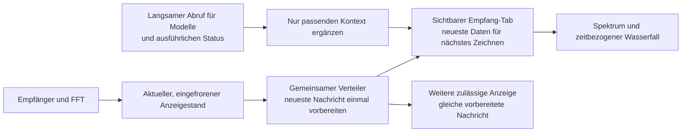

# Live-Spektrum und Wasserfall: Datenfluss, Bildrate und Grenzen

Die Spektrumanzeige erhält kleine, aktuelle Anzeigepakete über eine dauerhafte **WebSocket-Verbindung** zwischen Browser und lokaler Anwendung. Modellentscheidungen und ausführlicher Kontrollstatus werden seltener abgerufen. Dadurch muss ein neues Spektrumbild weder eine Modellberechnung noch das Lesen gespeicherter Experimentberichte auslösen.

Das ist eine Trennung der Arbeitswege, keine Zusage eines bestimmten Durchsatzes am Funkempfänger. **SDR** steht für *Software Defined Radio*, einen softwaredefinierten Funkempfänger. Seine tatsächliche Aufnahmequalität, Überläufe und lückenloser Empfang müssen weiterhin am angeschlossenen Gerät geprüft werden. Eine flüssige Anzeige bestätigt diese Eigenschaften nicht.

## Drei unterschiedliche Takte

| Takt | Was geschieht? | Einstellbare beziehungsweise vorgegebene Rate |
| --- | --- | --- |
| Aufnahme und Signalverarbeitung | Der Empfänger liefert digitale **IQ-Daten**, also Inphase- und Quadraturkomponenten des Funksignals. Daraus entstehen Spektren und gegebenenfalls Aufnahmen. | Abtastrate und Verarbeitungsfähigkeit des konkreten Aufbaus; nicht die Bildrate des Browsers. |
| Veröffentlichung eines neuen Spektrums | Die bereits berechnete schnelle Fourier-Transformation, englisch *Fast Fourier Transform* (**FFT**), beschreibt die Energieverteilung über der Frequenz. Der Empfänger stellt daraus einen aktuellen Anzeigestand bereit. | Für nicht ausdrücklich gesetzte Einstellungen der Sollwert 15 Aktualisierungen pro Sekunde; `spectrum_refresh_hz` erlaubt 1–30. Bereits ausdrücklich gespeicherte Werte bleiben erhalten. Blockdauer und Verarbeitung begrenzen den tatsächlichen Takt. |
| Übertragung und Zeichnen | Die Verbindung überträgt den neuesten verfügbaren Stand. Der Browser fasst eingetroffene Änderungen für das nächste Zeichnen zusammen. | Standardanfrage 15 Bilder pro Sekunde; die Anzeige bietet 8, 15 oder 20 als Sollwerte. Verbindung, Quelle und Browser begrenzen die tatsächlich erreichbare Rate. |

Ein höherer Anzeigesollwert erzeugt keine zusätzliche FFT, wenn die Quelle langsamer neue Daten bereitstellt. Es werden keine Zwischenmessungen interpoliert. Auch ein sehr schneller Bildschirm erzeugt keine weiteren Funkbeobachtungen.

Die ausführlichen Modell-/Analysemetadaten aus `/api/spectrum` und der Kontrollstatus werden getrennt im Abstand von etwa 1,8 Sekunden angefragt. Das hält die Modellberechnung aus dem schnellen Bildpfad. Der Kontrollstatus zählt archivierte Experimente und Modelle weiterhin direkt in der Datenbank mit **SQL**, *Structured Query Language*. Die seit Version 0.5.3 vermiedene vollständige Einlesung großer archivierter Berichte wird dadurch nicht wieder eingeführt.

## Ein gemeinsamer aktueller Frame statt wachsender Warteschlangen

Ein Frame ist ein Anzeigepaket für einen bestimmten Stand. Alle verbundenen Browser verwenden denselben Verteiler, den `SpectrumHub`. Er bereitet den neuesten Frame gemeinsam vor und serialisiert ihn einmal als **JSON**, *JavaScript Object Notation*, ein Textformat für strukturierte Daten. Jede Verbindung erhält diese vorbereitete Nachricht; der Server legt dafür keine eigene Frame-Warteschlange je Client an.



Ein langsamer Client überspringt ältere Zwischenframes und erhält anschließend den neuesten verfügbaren Stand. Er arbeitet keine veraltete Warteschlange ab. Wenn kein Client verbunden ist, ruht der Verteiler und erstellt keine Übertragungspakete. Der schnelle Pfad greift weder auf IQ-Daten noch auf Modelle oder Datenbanken zu; er verwendet ausschließlich den bereits veröffentlichten Anzeigestand.

Wenn gerade kein neuer Anzeigestand vorliegt, kann die Verbindung eine kleine `heartbeat`-Nachricht senden. Diese bestätigt nur den Transportzustand und erzeugt weder ein neues Spektrum noch eine zusätzliche Wasserfallzeile.

Die ausgelieferte Anwendung erlaubt **höchstens vier gleichzeitige Streamverbindungen**. Ein zusätzlicher Verbindungsversuch wird mit WebSocket-Code `1013` abgewiesen. Ein Anzeigepaket ist auf **256 Kibibyte (KiB)** begrenzt; ein KiB entspricht 1024 Bytes. Eine Sendung darf höchstens zwei Sekunden blockieren. Bei einem langsamen oder abgebrochenen Transport wird die Verbindung beendet, statt den Aufnahmeweg auf den Browser warten zu lassen.

Der Server begrenzt außerdem vom Client eingehende WebSocket-Nachrichten auf 4096 Bytes und eine Warteschlange mit einem Eintrag. Das ist eine **Eingangsgrenze**, keine Begrenzung ausgehender Spektren auf 4096 Bytes. Empfangssteuerung und Konfiguration erfolgen weiterhin über die üblichen Programmschnittstellen.

## Sichtbarkeit, Wiederverbindung und Ersatzweg

Der Browser betreibt den schnellen Stream nur, solange der **Empfang-Tab sichtbar** ist. Beim Wechsel in einen anderen Anwendungstab oder beim Verbergen der Browserseite wird die Verbindung geschlossen. Die Quelle und eine laufende Aufnahme werden dadurch nicht gestoppt. Eine ausdrücklich eingeschaltete automatische Hintergrundanalyse bleibt ebenfalls eine getrennte Aufgabe. Nach Rückkehr öffnet die Oberfläche die Verbindung neu.

Zum Zeichnen dient `requestAnimationFrame`, die vom Browser koordinierte Anforderung für die nächste Bildausgabe. Treffen vorher mehrere Anzeigestände ein, wird der jüngste verwendet. Die Anwendung zeichnet die Zwischenstände nicht verspätet nacheinander. Nach einer neuen Verbindung werden die clientseitige Verbindungsgeneration und Sequenzprüfung neu angesetzt, damit alte Antworten keinen aktuellen Zustand überschreiben.

Bei einer Verbindungsstörung versucht die Oberfläche mit zunehmenden Warteabständen erneut zu verbinden. Währenddessen kann sie alle **500 Millisekunden** den günstigen Ersatzendpunkt `/api/spectrum/frame?bins=1024` abrufen. Das entspricht höchstens zwei Abrufen pro Sekunde und liefert daher keine gleichwertige hohe Bildrate. Der Ersatzweg verwendet dieselbe einfache Frame-Struktur; er führt keine Modellinferenz aus. Der teurere ältere Aufruf `/api/spectrum` wird dafür nicht in eine schnelle Ersatzschleife aufgenommen.

Die Verbindungsanzeige zählt **neu eingetroffene FFT-Beobachtungen**, nicht bloße Zeichenaufrufe, Statuspakete oder Heartbeats. Liegt bei laufendem Empfang die letzte neue FFT-Beobachtung mehr als 2,5 Sekunden zurück, wird die Anzeige als veraltet bezeichnet. Bleiben auf einer offenen Verbindung länger als sechs Sekunden auch Nachrichten aus, wird eine Wiederverbindung angestoßen. Eine verbundene Verbindung und frische Messdaten sind damit getrennte Zustände.

## Was ein Frame enthält

WebSocket und einfacher Ersatzabruf verwenden dieselbe Hülle:

```text
{
  type: "spectrum",
  sequence: aktuelle Capture-Revision,
  frame: begrenzter Anzeigestand
}
```

Dies ist eine Strukturskizze, kein Messbeispiel. Im `frame` stehen unter anderem Spektralwerte, Frequenzbezug, Beobachtungszeit, Detektionen und ein kleiner Empfängerstatus. Roh-IQ, trainierte Gewichte und Modellvorhersagen gehören nicht zu diesen schnellen Nachrichten.

| Feld | Bedeutung |
| --- | --- |
| `sequence`, `frame.frame_id` | Monotoner Anzeigestand des laufenden Backendprozesses, auch über einzelne Empfangsneustarts hinweg. Ein Statuswechsel kann ihn ebenfalls erhöhen. |
| `frame.spectrum_frame_id` | Kennung des tatsächlich dargestellten Spektral- und Zeitkontexts. Ein reiner Statuswechsel bedeutet damit keine neue Wasserfallbeobachtung. |
| `frame.session_id`, `frame.receiver.session_id` | Empfangssitzung, auf die sich das Paket bezieht. |
| `frame.sample_rate`, `frame.center_frequency_hz` | Abtastrate und Mittenfrequenz dieses Anzeigekontexts. |
| `frame.timestamp`, `frame.analysis_timestamp` | Ursprünglicher Zeitbezug der veröffentlichten Spektralanalyse, nicht die spätere Ankunftszeit im Browser. |
| `frame.frequencies_hz`, `frame.power_dbfs` | Begrenzte Frequenz- und digitale Pegelwerte für die Darstellung. |
| `frame.original_bin_count`, `frame.display_bin_count`, `frame.bin_aggregation` | Ursprüngliche und übertragene Zahl von Frequenzintervallen sowie die verwendete Verdichtung. |
| `frame.classification_enabled` | Ob automatische Klassifikation für diese Empfangssitzung eingeschaltet ist; das ist keine Modellentscheidung. |
| `frame.receiver.performance` | Begrenzte Empfangskennzahlen wie Verarbeitung, Queue-Höchststand und gemeldete Überläufe. |

Ein Frequenzintervall der FFT wird häufig **Bin** genannt. Der schnelle Endpunkt ist für `bins=1024` ausgelegt: Er liefert höchstens 1024 Werte, bei weniger ursprünglichen Intervallen entsprechend weniger. Bei der Verdichtung wird der größte vorhandene digitale Pegel innerhalb eines Anzeigeintervalls verwendet, damit schmale Spitzen nicht durch reine Mittelung verschwinden. `bin_aggregation: "peak_max_dbfs"` kennzeichnet diese Projektion. Sie erzeugt keine höhere Frequenzauflösung und keine zusätzliche Leistungsmessung.

**dBFS** bedeutet *Decibels relative to Full Scale*: einen digitalen Pegel relativ zum Vollmaß. Er ist keine kalibrierte Angabe der Leistung an der Antenne. Zeitstempel stammen aus dem Host, also dem Empfangsrechner. Die Abkürzung **RF**, *Radio Frequency*, bezeichnet Hochfrequenz; `rf_timestamp_verified: false` bleibt ausdrücklich möglich. Ein solcher Host-Zeitstempel ist kein verifizierter Zeitstempel einzelner Hochfrequenzsamples.

## Modelltexte gehören zum richtigen Empfangskontext

Die schnelle Spektralkurve kann neuer sein als das zuletzt berechnete Klassenlabel. Beim Ergänzen der langsameren Metadaten prüft die Oberfläche Sitzung, Quelle, Mittenfrequenz, Abtastrate und Zeitbezug. Die Zeitangaben dürfen höchstens 2,5 Sekunden auseinanderliegen. Nicht passende Zuordnungen werden verworfen; alte Modelltexte werden nicht allein wegen einer ähnlichen Darstellung auf ein anderes Frequenzfenster übertragen.

Eine ausgeschaltete Klassifikation hat Vorrang: Später eintreffende Antworten eines älteren eingeschalteten Kontexts schalten die Anzeige nicht wieder ein. Fehlende oder nicht mehr passende Aussagen bleiben unbekannt beziehungsweise sichtbar deaktiviert. Die Einzelheiten der inhaltlichen Entscheidung beschreibt die [Entscheidungsarchitektur](entscheidungsarchitektur.md).

## Wasserfall: gespeicherte Beobachtungen und leere Zeitbereiche

Der Wasserfall ordnet empfangene Spektralbeobachtungen entlang ihrer ursprünglichen Zeitstempel an. Er verwendet nicht die Ankunftsreihenfolge im Browser als vermeintlich gleichmäßige Messzeit. Bereits bekannte Spektralbeobachtungen werden nicht durch Statusupdates zu zusätzlichen Zeilen vervielfacht.

Die darstellbare Zeitspanne ist auf **höchstens 600 Sekunden** begrenzt. Der Speicher hält außerdem höchstens **12.000 Zeilen**. Ältere Zeilen werden entfernt, wenn Zeit- oder Mengengrenze erreicht ist. Der Wasserfall verdichtet die Frequenzachse auf höchstens **512 Spalten** durch Mittelung der linearen Leistung; die Anzeige wird anschließend wieder in digitale Dezibelwerte umgerechnet. Dies kann schmale Spitzen gegenüber der getrennten Spektrallinie abschwächen.

Für die Zeitachse werden Beobachtungen, die in denselben Bildschirm-Zeitpixel fallen, in einem begrenzten Anzeigecache zusammengefasst. Dabei gilt je vorhandener Frequenzspalte das **Maximum über diese Zeitbeobachtungen**. Das erhält nicht automatisch Spitzen über zuvor gemittelte Frequenzintervalle und erzeugt keine neue Messung. Der Cache vermeidet unveränderte Verdichtungen bei jedem Zeichnen. Detektions- und Klassifikationsdaten werden nicht aus diesen verdichteten Wasserfall-Anzeigewerten neu abgeleitet.

Zwischen nicht beobachteten Zeitpunkten bleiben Bereiche leer. Ein fehlender Anzeigeframe kann durch Veröffentlichungstakt, Verbindung, Sichtbarkeitswechsel oder das absichtliche Überspringen älterer Frames entstehen. Er beweist weder einen Geräteüberlauf noch lückenlosen Empfang. Umgekehrt schließen sichtbare regelmäßig eintreffende Frames eine Lücke in der eigentlichen Aufnahme nicht aus. Für die Aufnahmeintegrität sind deren gemeldete Überläufe, Sampleindizes und gesonderte Qualitätsangaben maßgeblich.

Der Wasserfall ist damit eine **begrenzte Ansicht übertragener Beobachtungen**, kein vollständiges Langzeitarchiv aller IQ-Samples. Die Unterschiede zwischen Anzeigeverwerfung und tatsächlichem Aufnahmeüberlauf sollten bei der Diagnose erhalten bleiben; siehe [Aufnahmeleistung und Diagnose](aufnahme.md).

## Programmschnittstellen und Installation

Eine **API**, *Application Programming Interface*, ist eine Programmschnittstelle. Für den Zugriff verwendet der Browser je nach Transport WebSocket oder **HTTP**, *Hypertext Transfer Protocol*. Die folgenden Pfade beziehen sich auf dieselbe laufende lokale Anwendung:

| Pfad | Zweck und Grenzen |
| --- | --- |
| `/api/spectrum/stream?max_fps=15&bins=1024` | WebSocket-Livedaten; `max_fps` ist zwischen 1 und 30 zulässig, `bins` muss 1024 sein. |
| `GET /api/spectrum/frame?bins=1024` | Günstiger einzelner Anzeigeframe in derselben Hülle. |
| `GET /api/spectrum/stream/status` | Zahl verbundener Clients, veröffentlichte Frames, letzte Serialisierungsdauer, Sequenz und gegebenenfalls Streamfehler. |
| `GET /api/spectrum` | Bisheriger ausführlicher Spektrum-/Klassifikationsstatus; kein schneller Anzeigepoll. |
| `GET /api/status` | Allgemeiner Kontrollstatus mit kleinen Datenbankzählungen und Streamstatus. |

Falls ein Browser beim Verbindungsaufbau den Header `Origin` mitsendet, muss er eine `http`- oder `https`-Adresse mit demselben Host einschließlich Port wie die Anwendung angeben. Fremde Ursprünge und der Wert `null` werden mit Code `1008` abgewiesen. Lokale Kommandozeilenclients dürfen `Origin` weglassen. Das ist eine Ursprungsprüfung und keine Benutzeranmeldung.

Die WebSocket-Unterstützung ist als Kernabhängigkeit `websockets>=14,<17` aufgenommen. `start.sh` prüft ihren Import und startet bei einer fehlenden Abhängigkeit das vorhandene Setup. Bei Installation oder Aktualisierung kann dafür Internetzugang erforderlich sein. Ein normaler Start nach erfolgreicher Einrichtung benötigt keinen erneuten Paketdownload. Bei direktem Start unter Umgehung des Starthelfers fehlende Kernabhängigkeiten zuvor mit `./setup.sh` einrichten.

Diese Arbeitsweise gilt auch unter **WSL**, *Windows Subsystem for Linux*, der Linux-Umgebung unter Windows. Softwareprüfungen können den Datenvertrag, begrenzte Speicher, Wiederverbindung und Zeit-/Kontextzuordnung kontrollieren. Eine Abnahme von physischem Empfang, dauerhafter Zielbildrate und realer Windows-/WSL-Leistung ist davon getrennt und wird durch den neuen Transport nicht behauptet.
