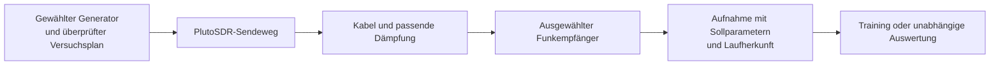

# Signalgenerator: kontrollierte Funkversuche im Labor

Der Tab **Signalgenerator** plant bekannte Sendesignale und deren Aufnahme für Klassifikationsexperimente. Ein solcher Lauf verbindet eine definierte Signalquelle mit einem tatsächlichen Empfänger. Fehlende Hardware oder fehlende Generatoren werden als Fehler beziehungsweise nicht verfügbar angezeigt; sie werden nicht still durch einen anderen Modus ersetzt.

**TX** steht für *Transmit*, den Sendeweg, **RX** für *Receive*, den Empfangsweg. Standard ist **Pluto TX → Kabel → SDRplay RSP1A**. Alternativ sind ein zweiter Pluto, ein gemeinsam verwendeter Pluto mit einem einzigen Gerätehandle und eine ausdrücklich gewählte Antennenmessung vorgesehen. Der tatsächliche Aufbau wird in jeder Aufnahme dokumentiert. Bei Kabelbetrieb muss die Dämpfung zum Ausgangspegel und zur zulässigen Eingangsleistung des Empfängers passen. Übersteuerung kann einen Klassifikationsversuch verfälschen und ist keine bestätigte Modulationseigenschaft. Bei Antennenbetrieb müssen Frequenz, Leistung und Betriebsart für den eigenen Testbetrieb zulässig sein; die Hardwaregrenzen der Anwendung sind keine Frequenzzuteilung.



## Ein Lauf in der Oberfläche

1. Im Tab **Signalgenerator** ein tatsächlich verfügbares Generatorprofil auswählen. Ein reiner Referenzeintrag aus dem Verfahrenskatalog ist noch kein ausführbarer Generator.
2. Sendequelle, Empfangsquelle, Frequenz, Bandbreite, Rate, Dauer und vorhandene Varianten beziehungsweise Störungen einstellen. **Plan prüfen** erstellt die Vorschau; diese Aktion sendet noch nicht.
   Bei profilspezifischen Fehlern bietet **Beanstandete Profile abwählen** die gemeinsame Entfernung aller betroffenen Profile an, auch wenn nur einzelne Varianten nicht passen. Die übrige Auswahl wird automatisch erneut geprüft; Parameter-Overrides der entfernten Profile werden gelöscht. Bleibt kein Profil übrig, eine neue Auswahl treffen. Globale Speicher-/Budgetfehler allein bieten keine Profilentfernung an.
3. Den gewählten Kabel-/Antennenaufbau herstellen und prüfen. **Messaufbau bestätigt** und **Senden ausdrücklich freigeben** sind getrennt vom Erstellen des Plans. Änderungen am Plan entwerten diese Freigaben.
4. **Geplanten Lauf starten** ausführen. Der Empfang ist währenddessen für diesen Lauf reserviert. Ein parallel gestarteter manueller Empfang soll diese Sitzung nicht übernehmen.
5. Über **TX & Lauf stoppen** beenden, wenn nötig. Anschließend Plan, Laufmanifest und erhaltene Aufnahmen prüfen beziehungsweise herunterladen. Für einen späteren Vergleich die tatsächlich verwendeten Parameter und die Herkunft gemeinsam aufbewahren.

## Einrichtung und ausführbare Auswahl

Die nativen Generatoren benötigen die vorhandenen NumPy-/SciPy-Abhängigkeiten. Für den Pluto werden zusätzlich die bestehenden Treiber und `pyadi-iio` benötigt; [Treiberinstallation](install-driver.md). Für die zusätzlichen externen Profile optional im Projektverzeichnis ausführen:

```bash
./install_onair.sh
```

Der Helfer lädt die unveränderte portable OnAir-Distribution **4.6.0 für Linux/WSL x86_64** mit etwa 187 MB, prüft ihre festgelegte SHA-256-Prüfsumme und installiert sie samt Bibliotheken und Lizenzhinweisen unter `~/.local/share/signalclassifier/onair/`. Die Anwendung findet `current/bin/onair-cli` automatisch. Alternativ kann `SIGNALCLASSIFIER_ONAIR_CLI` auf eine separat installierte ausführbare CLI zeigen. Bibliotheken der verwalteten Distribution werden nur im externen Unterprozess verwendet und ersetzen nicht die Treiber der laufenden Anwendung. Der Installer führt weder einen Generator noch einen Sender aus. Der Katalog kann danach neu geladen werden.

Der geprüfte Stand enthält **30 native Profile** und **301 registrierte externe Generatorprofile**. Die Website beschreibt 392 Modi, enthält aber 393 Referenzeinträge einschließlich einer Plugin-Verwaltungsseite und weiterer Werkzeuge. Diese Zahlen sind ausdrücklich keine Anzahl vollständig nachgewiesener Funkprotokollencoder. Quelle für das externe Register ist OnAir-Commit `2f35f509d540ee3b4157affe0a2ce0f9a01a6859` aus Release 4.6.0. Der Installer verwendet die Archivprüfsumme `684de24a747837007c1c9ce8fd751c7d7c6a32fb946d0b79c888c959a044ad0c`.

Native Profile umfassen AM/FM, Seitenbandmodulation, ASK/FSK/PSK/QAM, generisches OFDM, generische Chirps sowie Träger/Rauschen als Kontrollsignale. AX.25 mit Bell-202-Audio-FSK und optionaler FM sowie alphanumerisches POCSAG mit 512/1200/2400 Baud besitzen eigene Rahmenencoder mit Prüfvektoren. Ein allgemeines OFDM-Muster ist kein WLAN-/DVB-Rahmen; ein allgemeiner Chirp ist kein LoRa-Encoder. Die externen Profile werden deshalb zusätzlich als **Testvorlagen** bezeichnet.

Dabei stehen AM und FM für Amplituden- und Frequenzmodulation. ASK, FSK und PSK bezeichnen Amplituden-, Frequenz- und Phasenumtastung digitaler Symbole; QAM kombiniert Amplituden- und Phasenwerte. OFDM verwendet viele orthogonale Unterträger. Diese Wellenformbegriffe beschreiben noch keinen vollständigen Nachrichtenstandard.

Die OnAir-CLI stellt nicht für jedes Profil neue Nutzdaten bereit. Ihre Generatorsamples sind intern auf 8-Bit-Stufen quantisiert, auch bei Speicherung als komplexe Fließkommazahlen. Die Anwendung verlangt registrierte Kennungen, prüft Datei-/Metadatenrate und Modusfamilie und kennzeichnet bewusst ausgewählte IQ-Ausschnitte. Ein solcher Ausschnitt beweist keinen vollständigen Protokollzyklus. Fehlende Engine, ungeeignete Rate, zu große Wellenform und abweichende Metadaten werden sichtbar abgewiesen; kein anderer Modus wird ersatzweise gesendet.

## Frequenz, Pegel und Variationen

Die Frequenzen sind frei innerhalb des gemeinsamen Hardwarebereichs wählbar: mit unverändertem Pluto als Sender und RSP1A als Empfänger **325 MHz bis 2 GHz**, mit Pluto als Empfänger grundsätzlich bis **3,8 GHz**. Der Laborpfad begrenzt die RX-Rate zusätzlich auf 10 Millionen Samples pro Sekunde. Stock-Pluto-Grenzen werden nicht durch Firmwareänderung erweitert. Das Signal darf für einen Kabelversuch auf einer anderen Trägerfrequenz als seinem üblichen Funkdienst liegen; das Protokoll-/Modulationslabel wird aus der Quelle abgeleitet, nicht aus dem Frequenzband.

Der manuelle TX-Gain ist eine relative Hardwareeinstellung in Schritten von **0,25 dB**, kein kalibrierter Ausgangspegel in dBm. Zusätzliche Dämpfungswerte werden ausschließlich **abgezogen**. Beispiel: Basis `-35 dB`, zusätzliche Dämpfung `[0, 3, 9]` ergibt `[-35, -38, -44] dB`. Kein Fall überschreitet den manuellen Basiswert. Werte unter `-89,75 dB` oder über `0 dB` werden abgewiesen. Tatsächliche Frequenz, Rate, Filterbandbreite und TX-Gain werden zurückgelesen; unverträgliche Werte verhindern den Sendestart.

Variationen umfassen die freigegebenen Parameter des jeweiligen Profils, frische Nutzdaten-Seeds, Frequenz, zusätzliche Dämpfung sowie optionale Softwareänderungen für das Signal-Rausch-Verhältnis (SNR, *signal-to-noise ratio*), Trägerfrequenzversatz, Abtastratenabweichung, zeitliches Jitter, IQ-Amplituden-/Phasenfehler, Gleichanteil und Clipping. Die Softwarestörungen werden mit ihren tatsächlich angewendeten Zahlen und Seeds gespeichert. Ihre Rauschleistung ist mathematisch auf die Softwarevorlage bezogen, kein gemessener Funkkanal-SNR. Ein zyklischer Puffer wiederholt auch Rauschen und Randübergänge; diese Eigenschaft bleibt dokumentiert.

Der begrenzte, reproduzierbare Plan kombiniert gleichmäßig wiederkehrende Variationswerte, statt ein unbeschränktes vollständiges Kreuzprodukt zu bilden. Die Anzahl wird gegebenenfalls erhöht, damit jeder ausdrücklich eingegebene Wert vorkommt. Für Ursachenstudien jeweils nur einen Faktor variieren und die übrigen festhalten. Alle Klassen erhalten dieselben Frequenz- und Kanalwertelisten. Höchstens 4096 Fälle, ein begrenzter zyklischer TX-Puffer und das gewählte Gesamt-IQ-Budget werden vorab geprüft. Der Bedarf nach tatsächlich eingestellter RX-Rate wird vor jeder Datei erneut gegen das verbleibende Budget geprüft.

## Aufnahmequalität, Herkunft und spätere Experimente

Pro Fall wird der Sender zunächst stabilisiert. Ein eigener Hardware-Lesethread verwirft den eingestellten Einschwingumfang und schreibt anschließend exakt die zur tatsächlichen RX-Rate gehörende Samplezahl. Eine begrenzte Eingangsqueue trennt Gerätelesen und Datenträger. Überläufe werden nicht übersprungen: Der bereits geschriebene Präfix bleibt mit Fehlerangaben erhalten und bekommt kein bestätigtes Referenzlabel. Ausschließliches Null-IQ wird ebenfalls nicht bestätigt. Zeitangaben beruhen auf Host-Empfangszeiten; USB-Latenz und synchronisierte HF-Zeitstempel sind nicht nachgewiesen.

Aufnahmen verwenden **SigMF**, *Signal Metadata Format*. In `sc:generation` stehen Plan-/Fallkennung, Ziel-Facette, erwartetes Label, Generatorparameter, Seeds, logischer Nutzdatenursprung, tatsächliche TX-/RX-Einstellungen, Wellenformprüfsummen, Störungen, Messaufbau und Abschaltstatus. Automatisch nutzbare Labels tragen `verification_kind=generator_reference` und `human_verified=false`. Sie bestätigen weder menschliche Prüfung noch eine unabhängige Decodierung der Empfangsklasse. Das Laufmanifest enthält abgeschlossene, fehlgeschlagene und abgebrochene Fälle.

Im Experiment-Setup kann **Vorgeplante Generator-Kohorten verwenden** zusammen mit der Zustimmung zu Aufnahmen derselben Sitzung aktiviert werden. Damit bleiben sämtliche Varianten desselben Nutzdatenursprungs in Training, Validierung oder Test. Klassen und Facetten müssen vollständig zum Plan passen; widersprüchliche oder fehlende Herkunft wird nicht zufällig aufgefüllt. Für einen reinen Modulationsvergleich das Labelziel **Modulation**, für konkrete Generatorprofile **Verfahren** wählen; Modulations- und Protokollachsen nicht als gleichartige Klassen mischen.

Externe feste Demo-Nutzdaten sowie Träger-/Chirp-Kontrollsignale erhalten keine erfundenen frischen Nutzdatenkohorten: Sie sind im Plan zunächst nur Trainingsdaten. Für eine unabhängige Bewertung zusätzliche geeignete Ursprünge bereitstellen oder ausdrücklich **Nur trainieren** verwenden. Auch native neue Nutzdatenkohorten aus einem Kabelaufbau belegen noch keine Generalisierung auf andere Geräte oder reale Fremdsender. Ein einzelnes Experiment mit einem künstlichen neuronalen Netz (ANN, *artificial neural network*) bleibt auf 64 Klassen begrenzt; größere Kataloge benötigen getrennte, fachlich passende Experimente beziehungsweise Spezialmodelle.

Generator, normaler Empfang und Scanner verwenden den Empfänger exklusiv. Ein Stopp ist mit Sendestarts synchronisiert und hängt nicht vom Fortschritt des Datenträgers ab. Ein noch laufender Treiberaufruf behält seine Ressourcensperre bis zu seinem tatsächlichen Ende. Unbestätigte Abschaltung wird als unbekannt angezeigt. Der TX-Adapter versucht unter anderem LO-Powerdown, maximale Dämpfung und Pufferzerstörung; das sind Treiberbestätigungen, keine gemessene HF-Abschaltung. Ein Hostabsturz kann zyklisches TX weiterlaufen lassen. Bei unklarem Zustand die Sendehardware physisch abschalten; unterbrochene Kampagnen werden niemals automatisch fortgesetzt.

Private Berichtsbundles bewahren die vollständige Provenienz. Der getrennte öffentliche Paper-Export übernimmt nur bekannte Generatorparameter und Kennzahlen; Geräteadressen, Freitexte, externe Prozesslogs, IQ-Dateien und Gewichte bleiben ausgeschlossen. Die Unterscheidung zwischen Generatorreferenz und unabhängig bestätigtem Empfang wird auch dort erhalten.

Ein höherer Wert in einem Auswahlfeld erweitert keine Hardwaregrenze. Stock-PlutoSDR ist für 325 Megahertz bis 3,8 Gigahertz spezifiziert; der SDRplay RSP1A reicht von 1 Kilohertz bis 2 Gigahertz. **Hertz (Hz)** bezeichnet Schwingungen pro Sekunde; die Vorsilben Kilo, Mega und Giga entsprechen tausend, einer Million und einer Milliarde. Für diese beiden Geräte liegt der gemeinsame spezifizierte Frequenzbereich somit nur zwischen 325 Megahertz und 2 Gigahertz. Ein kontrollierter Vergleich von Amplitudenmodulation (**AM**) und Frequenzmodulation (**FM**) auf einem gemeinsamen Laborkanal kann die Unabhängigkeit von der Trägerfrequenz untersuchen. Er ersetzt keine Feldaufnahmen von UKW-Radio oder Flugfunk auf deren tatsächlichen Frequenzen.

Die nutzbare Bandbreite hängt zusätzlich von beiden Geräten, den eingestellten Abtastraten, den Treibern und dem dauerhaften Datenfluss ab. Eine Angabe „0–6 Gigahertz“ im Katalog ist keine Zusage, dass die vorhandene Gerätekombination diesen Bereich senden oder gleichzeitig empfangen kann. Nicht passende Konfigurationen müssen vor dem Start sichtbar bleiben.

## Drei verschiedene Arten von Katalogeinträgen

| Eintrag | Wofür er verwendet werden kann |
| --- | --- |
| Tatsächlicher Generator | Erzeugt die konkret implementierte Signalform beziehungsweise das implementierte Protokoll innerhalb seines dokumentierten Parameterbereichs. Das beweist noch keine vollständige Normkonformität oder Erkennbarkeit unter Feldbedingungen. |
| Modulationsproxy | Erzeugt eine vereinfachte ähnliche Signalform für einen begrenzten Versuch. Er ist kein Ersatz für gültige Nutzdaten oder den vollständigen Ablauf eines Protokolls. Ein Proxy darf nicht als bestätigter Protokollsender gelabelt werden. |
| Nicht verfügbar / Referenz | Dient zum Nachschlagen von Verfahren oder Anforderungen. Der Eintrag wird nicht durch eine beliebige andere Signalquelle ausführbar gemacht. |

Ein „Proxy“ ist hier ein vereinfachtes Ersatzmodell. Seine Aussagegrenze muss in Plan und Ergebnis erhalten bleiben. Insbesondere bestätigt ein Signal mit einer ähnlichen Modulationsform weder ein gültiges Funkprotokoll noch einen realen Gerätetyp.

## OnAir: Verfahrensreferenz und ausführbare Generatoren trennen

[OnAir](https://on-air.dev/) ist eine externe Funksoftware. Die öffentliche Website nennt **392 Modi in 14 Familien**. Der am 24. November 2026 erfasste öffentliche Katalog enthält **393 einzelne Einträge** einschließlich **Plugins**; ohne diesen Erweiterungseintrag bleiben 392. Diese mögliche Erklärung wird von der beobachteten Eintragszahl getrennt gehalten. Die Liste enthält außerdem Messwerkzeuge, Scanner, Netzwerkempfänger und wissenschaftliche Auswertungen. Sie ist keine Liste von 393 vollständig implementierten Funkprotokollen.

[`onair-modes.json`](../signalclassifier/data/onair-modes.json) speichert nur Namen, Kennungen, Familien, Quellenverweise, eine ausdrücklich redaktionelle Einordnung und belegte numerische Fakten. Eine dort angegebene Kanalbreite kann das gesamte Fenster eines Scanners beschreiben; sie ist nicht automatisch die Mindestbandbreite einer einzelnen Aussendung. Fehlende Werte bleiben unbekannt. Der Katalog übernimmt keine vollständigen Seitentexte und bestätigt weder einen Decoder noch einen Generator pro Eintrag.

Die Website beschreibt für viele Modi Prüfungen mit erzeugten Signalen. Der häufig wiederholte Hinweis, dass „die meisten Modi“ einen synthetischen Test anbieten, beweist keinen exportierbaren Generator für jeden Eintrag. Selbst eine modusspezifische Demo beweist noch keinen passenden Sendepfad. Der tatsächliche externe Generatorbestand wird deshalb getrennt aus dem überprüften Programmvertrag geführt. Die Oberfläche zeigt Verfügbarkeit und Einschränkungen des jeweiligen Eintrags.

Eine Websitekennung ist kein zulässiger Programmparameter: `onair-catalog:<webslug>` identifiziert einen Referenzeintrag. Ein ausführbarer externer Generator verwendet dagegen eine ausdrücklich registrierte Kennung wie `onair:<cli-standard>`. **CLI** bedeutet *Command-Line Interface*, die Kommandozeilenschnittstelle. Unbekannte oder nur ähnlich geschriebene Kennungen dürfen nicht ungeprüft an das externe Programm weitergegeben werden; eine dortige Standardauswahl wäre ein falsches Sollsignal.

Quelle und Attribution: [OnAir-Quellprojekt von Kristijonas Adomaitis und Mitwirkenden](https://github.com/adswill/OnAir), [öffentlicher Verfahrenskatalog](https://on-air.dev/modes/). Das OnAir-Projekt bezeichnet seine Softwarelizenz als **GPL-3.0-or-later**, die *GNU General Public License* ab Version 3. Externe Distributionen behalten ihre Lizenz- und Hinweisdateien. Die faktische Katalogreferenz ist keine Übernahme von OnAir-Implementierungscode und keine Zusage, dass alle externen Funktionen in SignalClassifier verfügbar sind.

## Erzeugte Sollsignale sind kein Feldnachweis

Das erwartete Label stammt zunächst aus der kontrollierten Sendekonfiguration. Es beschreibt die beabsichtigte Signalquelle und deren Parameter, nicht die Entscheidung eines unabhängigen Funkdecoders. Ein erzeugtes Signal bleibt eine erzeugte Versuchsvorlage, auch wenn es anschließend durch reale Sende- und Empfangshardware läuft. Der Kabelweg kann Gerätefehler, Rauschen und Übersteuerung sichtbar machen, repräsentiert aber nicht automatisch wechselnde Antennen, Mehrwegeausbreitung, fremde Sender oder andere Bedingungen im Feld.

Die digitalen Inphase- und Quadraturkomponenten (**IQ-Daten**) der Aufnahme, ihre Sollparameter und die Ursprungsgruppe müssen gemeinsam zugeordnet bleiben. Mehrere Ausschnitte desselben Laufs sind keine unabhängigen Messsitzungen. Für die Modellauswahl und den abschließenden Test ganze Ursprungsläufe getrennt halten und zusätzliche reale Aufnahmen zurückhalten. Die Qualität auf erzeugten Beispielen darf nicht als bereits gemessene Genauigkeit für unbekannte reale Funksignale bezeichnet werden.

Für die Bewertung weiterhin getrennt ausweisen: Fehler bei der Erzeugung, Empfangsqualität, Klassifikationsgüte und Laufzeiten auf dem dokumentierten Rechner. Auch ein erfolgreich erzeugter Lauf ersetzt keine Abnahme der Hardware oder eines universellen OnAir-Decoders. Weitere Grundlagen: [Experimentmethodik](quellen-und-methodik.md), [Aufnahmen und Empfänger](aufnahme.md), [getrennte Aussageebenen der Analyse](entscheidungsarchitektur.md).
